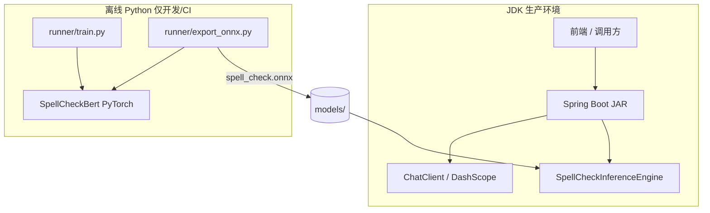

# B2C business 架构参考

## 整体架构



## 请求路径示例

### 1. LLM 对话（Spring AI）

```
GET /api/chat?message=你好
  → ChatController
  → ChatClient (DashScope qwen-plus)
  → 返回 { reply }
```

### 2. 文本纠错（ONNX，规划）

```
POST /api/spell-check  { "text": "今天天汽很好" }
  → SpellCheckController
  → SpellCheckService
  → SpellCheckInferenceEngine (ONNX Runtime)
  → 返回 { "text": "今天天气很好", "corrections": [...] }
```

## Java 包结构（目标）

```
com.uvgraph.b2c
├── B2cBusinessApplication
├── config
│   └── AppProperties.java          # data/models/checkpoint 路径
├── controller
│   ├── ChatController.java         # 已有
│   └── SpellCheckController.java   # 待建
├── service
│   ├── ChatService.java            # 可选：从 Controller 抽离
│   └── SpellCheckService.java      # 纠错编排
└── inference
    ├── SpellCheckInferenceEngine.java
    └── TokenizerHelper.java        # 加载 vocab / tokenizer 文件
```

## Python 训练结构（目标）

```
training/
├── configs/config.py
├── models/spell_check_bert.py
├── preprocess/
│   └── spell_check_dataset.py
├── runner/
│   ├── train.py
│   └── export_onnx.py
└── requirements.txt
```

## export_onnx.py 职责（待实现）

1. 加载 `checkpoint/best.pt` + `pretrained/bert-base-chinese`
2. 构造 dummy input（`input_ids`, `attention_mask`）
3. `torch.onnx.export(...)` → `models/spell_check.onnx`
4. 复制 tokenizer 相关文件到 `models/`

## application.yml 扩展示例

```yaml
app:
  models:
    spell-check-dir: ${SPELL_CHECK_MODEL_DIR:models}
    spell-check-onnx: spell_check.onnx

spring:
  ai:
    dashscope:
      api-key: ${DASHSCOPE_API_KEY}
      chat:
        options:
          model: qwen-plus
```

## 与 uvgraph 主项目关系

| 项目 | 角色 |
|---|---|
| uvgraph（Python FastAPI + LangGraph） | 问诊状态机、RAGgraph、Neo4j 检索 |
| B2C business（Java Spring Boot） | C 端独立业务服务：对话、纠错、后续 B2C 专属流程 |

两项目可并存：B2C 需要图谱检索时，Java 通过 HTTP 调 uvgraph `/api/raggraph/retrieve`，不在 B2C 内重复建 Neo4j 客户端（除非明确要求）。

## 迁移计划（Python src/ → training/）

1. 创建 `training/` 目录，移入 `configs/`、`models/`
2. 更新 `config.py` 中 `ROOT_DIR = Path(__file__).parent.parent.parent`（仍指向 B2C business 根）
3. 删除 `src/configs/`、`src/models/` 下 Python 文件
4. 添加 `training/requirements.txt`：`torch`, `transformers`, `onnx`, `onnxruntime`（export 用）

## pom.xml 后续依赖（推理阶段再加）

```xml
<!-- ONNX Runtime Java（SpellCheck 推理） -->
<dependency>
    <groupId>com.microsoft.onnxruntime</groupId>
    <artifactId>onnxruntime</artifactId>
    <version>1.20.0</version>
</dependency>
```

训练阶段不必加此依赖。
