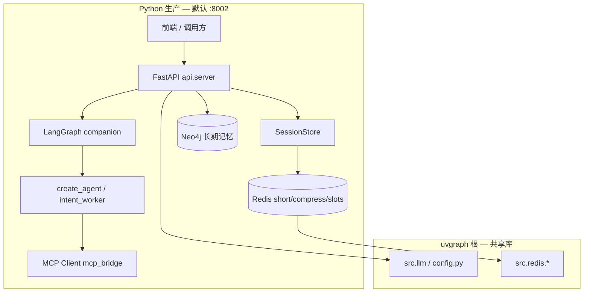

# B2C business 架构参考（Python 生产）

## 整体架构



## 请求路径示例

### 1. 陪聊一轮（主路径）

```
POST /api/chat/stream（或同类会话接口）
  → session 取/建 CompanionSession（session_id）
  → sync_b2c_session_memory → Redis short + slots
  → build_companion_graph.invoke（thread_id = session_id）
  → intent_worker（并行）→ merge（`algorithm/merge_reply` 去重拼接）
  → 可选 `COMPANION_PEER_HANDOFF=1` 二轮子图（默认关）
  → 返回 reply + 可选 tool_trace
```

### 2. 关场 / 空闲释放

```
release_companion_session
  → persist_session_findings（Neo4j Finding）
  → release_session_runtime_state（short/compress/checkpoint/slots）
  → SessionStore.drop
```

### 3. 长期记忆检索

```
search_facts / Graphiti 形态 API
  → uvgraph src.algorithm.user_memory（经 graphiti_store 封装）
```

## Python 包职责（`B2C business/src`）

| 包 | 职责 |
|----|------|
| `api` | HTTP、静态页、评测 API |
| `session` | 单场会话、槽位合并、关场前 user 消息 |
| `graph` | LangGraph 编译、checkpoint、路由 |
| `agent` | LangChain Agent、中间件链、HITL |
| `algorithm` | 意图、压缩、session_memory、预处理 |
| `memory` | ingest/search 门面 |
| `tools` | 本地工具 + MCP |
| `middleware` | Envelope、压缩、MCP 守卫 |

## 与 uvgraph / B2B 关系

| 项目 | 角色 |
|------|------|
| uvgraph 根 `src/` | Redis、LLM、Neo4j 用户记忆、全局配置 |
| B2C business | **C 端陪聊唯一生产服务**（8002） |
| B2B business（问诊 LangGraph） | 可选桥接 `b2c_b2b_bridge`，非 C 端默认路径 |

C 端**不**再经 Java Spring Boot 中转。需要图谱检索时在本进程 `algorithm/` 或 MCP 完成，避免重复维护第二套 HTTP 栈。

## 记忆双轨（运行时）

| 存储 | Key / 约定 |
|------|------------|
| 本场全量 | `conversation:short:{session_id}` |
| 本场摘要 | `conversation:compress:{session_id}` |
| 槽位 | `conversation:slots:{user_id}`，JSON 内 `session_id` 须与当前场一致 |
| LangGraph checkpoint | `session_id` / `agent:...`（非长期记忆） |

详见 `algorithm/session_memory.py` 与 `tests/test_session_memory.py`。

## 离线训练（非生产进程）

```
src/models/spell_check_bert.py
src/runner/Trainer.py | Predictor.py
```

训练在开发机或 CI 执行；产物供 Python 评测或后续服务内推理，**无 Java ONNX 加载路径**。

## 运维检查清单

1. `.env` 与主项目一致（DashScope、Redis、Neo4j）
2. `uv run python "B2C business/run.py"` 监听目标端口
3. `GET /healthcheck` → `{"status":"healthy"}`
4. Redis 可达（会话记忆）
5. MCP：改 `config.yaml` 后重启 API；`GET /api/tools` 核对
