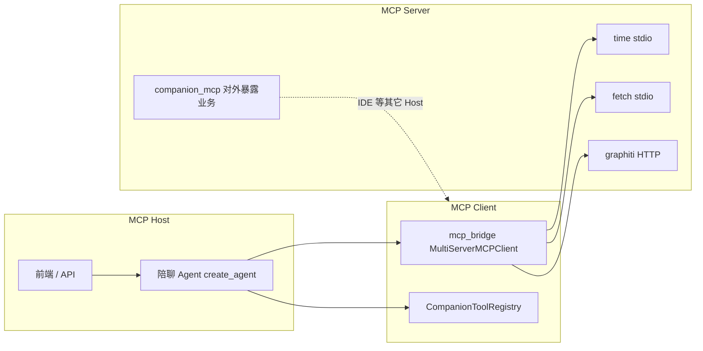

# C 端 MCP 架构与演进方向

陪聊 Python 栈（`B2C business/src`）里，MCP 用于**统一接入外部能力**；与 `CompanionToolEnvelope`（模型看到的工具结果格式）是不同层，见下文对照。

## 1. 复杂度：从 N×M 到 N+M

| 模式 | 含义 |
|------|------|
| **N×M** | 每个宿主 × 每个外部能力各写一套对接（参数、鉴权、发现、错误处理） |
| **N+M** | 宿主侧只实现 **一种 MCP Client**；能力方只实现 **一种 MCP Server**；新增能力改服务或配置，不改 Agent 主流程 |

**目标形态**：自定义业务能力与第三方能力，在「调用侧」都经 **同一套 MCP 协议 + 同一套 LangChain 工具入口** 进入 `create_agent`；本地仍可用 Python 实现，但**对外暴露与消费都优先 MCP Server**，避免再写专用 HTTP/胶水。

**当前状态**

- **MCP 连接与白名单**：唯一维护 `uvgraph/src/configs/config.yaml` → `mcp.servers.*`（`enabled`、`transport`、`majors`、`allow_tools`、展示用 `title`/`summary`/`operation_hint`）
- **登记**：`tools/setup.py` 启动时 `register_mcp_from_yaml`，**不再**手写 `register_mcp` 双写
- **桥接**：`tools/mcp_bridge.py` 按 YAML 建连；`tools/mcp_yaml_registry.py` 同步注册表
- **仍本地直挂**：`companion_tools` + `CompanionToolRegistry` + `INTENT_BIND`
- **统一给模型**：不论来源，中间件把 `ToolMessage` 收成 `CompanionToolEnvelope`

## 2. 三个核心角色（在 C 端的落点）

| 角色 | 职责 | 本仓库目录 / 模块 |
|------|------|-------------------|
| **Host** | 发起对话、组本轮工具集、跑 Tool Calling | `api/server.py`、`agent/companion_agent.py`、`graph/intent_worker.py` |
| **Client** | 连 Server、list/call tools、转成 `BaseTool` | `tools/mcp_bridge.py`（`langchain-mcp-adapters`） |
| **Server** | 提供工具实现与 schema | 第三方包 / 远程服务；本仓库 `companion_mcp/`（含 `stdio_*` 与 `server.py`） |

陪聊运行时：**Host + Client**；业务算法应写在 Server 或现有 `algorithm/`，由 Server 薄封装调用（`companion_mcp/server.py` 已按此原则：不复制算法）。

## 3. 两种传输方式

| 传输 | 适用 | C 端配置 |
|------|------|----------|
| **stdio** | 本机子进程（npm/npx 或 `python -m`） | `transport: stdio` + `command` / `args`；无 npx 时 bridge 自动映射到 `companion_mcp.stdio_time` / `stdio_fetch` |
| **streamable HTTP** | 独立部署的 MCP 服务（如 Graphiti） | `transport: streamable_http` + `url` |

配置权威源：`uvgraph/src/configs/config.yaml` → `mcp.servers.*`（连接 + 大类 + 工具白名单 + 调试台文案）。  
注册表由 `register_mcp_from_yaml` 自动生成；一致性见 `tests/test_config_consistency.py`。

## 4. MCP 协议 vs CompanionToolEnvelope

| | MCP | CompanionToolEnvelope |
|---|-----|------------------------|
| **层** | 宿主 ↔ 工具提供方（发现、调用、传输） | 工具执行完 → **模型**（`ok` / `usable` / `retryable` / `data`） |
| **谁维护** | 各 MCP Server + YAML 连接 | C 端 `schema/tool_result.py`、`tools/tool_envelope.py`、中间件 |
| **MCP Server 是否要懂 Envelope** | 否 | Host 侧 middleware 负责 normalize |

## 5. 运维：新增 / 维护一个外部 MCP

1. 部署或启用 **MCP Server**（实现与发布只动服务本身）。
2. `config.yaml` 增加 `mcp.servers.<name>`（`enabled`、`transport`、stdio 或 `url`、`majors`、`allow_tools`，可选 `title`/`summary`/`operation_hint`）。
3. 重启陪聊 API（`mcp_bridge` 有工具列表缓存）；跑 `tests/test_config_consistency.py` 确认登记与 YAML 一致。
5. 用 `GET /api/tools` 核对登记；用对应 **major** 的对话验证模型能调到工具。

**不必改**：`companion_agent` 拼装逻辑、`intent_worker` 的 `local + mcp_tools_for_major` 模式。

## 6. 演进清单（向脑图目标收敛）

- [ ] 高频本地工具按域拆成 **stdio MCP**（与 `companion_mcp/server.py` 同模式），Host 只保留 bridge + 注册表
- [x] MCP 元数据与连接统一在 `config.yaml`（`register_mcp_from_yaml`）
- [ ] 写操作类工具继续走 `McpGuardMiddleware` 与 `allow_tools` 白名单

## 7. 相关文件速查

| 文件 | 作用 |
|------|------|
| `src/configs/config.yaml` | `mcp.enabled` / `servers` |
| `tools/mcp_bridge.py` | Client：拉工具、按 major 过滤 |
| `tools/registry.py` / `setup.py` | 工具目录与 MCP 登记 |
| `tools/mcp_bridge.py` + `intent_worker.py` | 本轮工具集装配 |
| `middleware/mcp_guard.py` | 拦截危险 MCP 写操作 |
| `companion_mcp/server.py` | 本业务作为 MCP Server（供 Cursor 等） |
| `companion_mcp/stdio_*.py` | 无 npx 时的 stdio Server 替身 |

本地启动陪聊：`uv run python "B2C business/run.py"`（默认 8002）。
